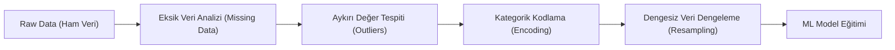

# ⚙️ Özellik Mühendisliği (Feature Engineering)

[](https://www.python.org/)
[](https://jupyter.org/)
[](https://scikit-learn.org/)
[](https://pandas.pydata.org/)
[](https://imbalanced-learn.org/)

Ham veriyi makine öğrenmesi modellerinin en yüksek doğruluk ve genellenebilirlikle öğrenebileceği sayısal özelliklere (feature) dönüştürme sanatı ve bilimi.

---

## 🧭 Özellik Mühendisliği Boru Hattı (Pipeline)



---

## 📚 Notebook Serisi ve İçerik Haritası

| Notebook | Konu & Odak Noktası | Kullanılan Teknikler | Çözülen Problem |
| :--- | :--- | :--- | :--- |
| **[`missing_data.ipynb`](missing_data.ipynb)** | **Eksik Veri (Missing Data)** | MCAR, MAR, MNAR analizi, Mean / Median / Mode Imputation, Deck sütunu eleme | Boş değerlerin veri kaybı ve model hatası yaratmasını engelleme |
| **[`handling_outlier.ipynb`](handling_outlier.ipynb)** | **Aykırı Değer (Outliers)** | 5 Sayı Özeti, Çeyrekler Açıklığı (IQR), Alt/Üst Çit formülleri, Seaborn Boxplot | Uç değerlerin doğrusal regresyon ve k-NN modellerini saptırmasını önleme |
| **[`label_encoding.ipynb`](label_encoding.ipynb)** | **Label & Ordinal Encoding** | `LabelEncoder`, `OrdinalEncoder`, Hiyerarşik sıra (`categories=[...]`) | Sıralı kategorik verileri (Small/Medium/Large) yapay ağırlık hatası olmadan dönüştürme |
| **[`one_hot_encoding.ipynb`](one_hot_encoding.ipynb)** | **One-Hot Encoding** | `OneHotEncoder(drop='first')`, Dummy Variable Trap önleme | Nominal verilerde (Renkler, Şehirler) üstünlük algısını yok etme |
| **[`target_guided_encoding.ipynb`](target_guided_encoding.ipynb)** | **Target Mean Encoding** | `df.groupby('cat')['target'].mean().to_dict()` eşleştirmesi | Yüksek kardinaliteli sütunlarda boyut patlamasını (Curse of Dimensionality) önleme |
| **[`imbalanced-data.ipynb`](imbalanced-data.ipynb)** | **Dengesiz Veri Kümeleri** | Çoğunluk/Azınlık sınıf analizi, `resample` ile Downsampling | Doğruluk Paradoksu (Accuracy Paradox) ve azınlık sınıfı tahmin başarısızlığı |
| **[`smote.ipynb`](smote.ipynb)** | **Sentetik Örnekleme (SMOTE)** | k-NN interpolasyonu ile yeni sentetik veri üretimi, 2D scatter görselleştirmesi | Mevcut verileri kopyalayarak aşırı öğrenme (Overfitting) yapmadan sınıf dengeleme |

---

## 🛠️ Kurulum ve Çalıştırma

```bash
pip install -r requirements.txt
jupyter notebook
```
