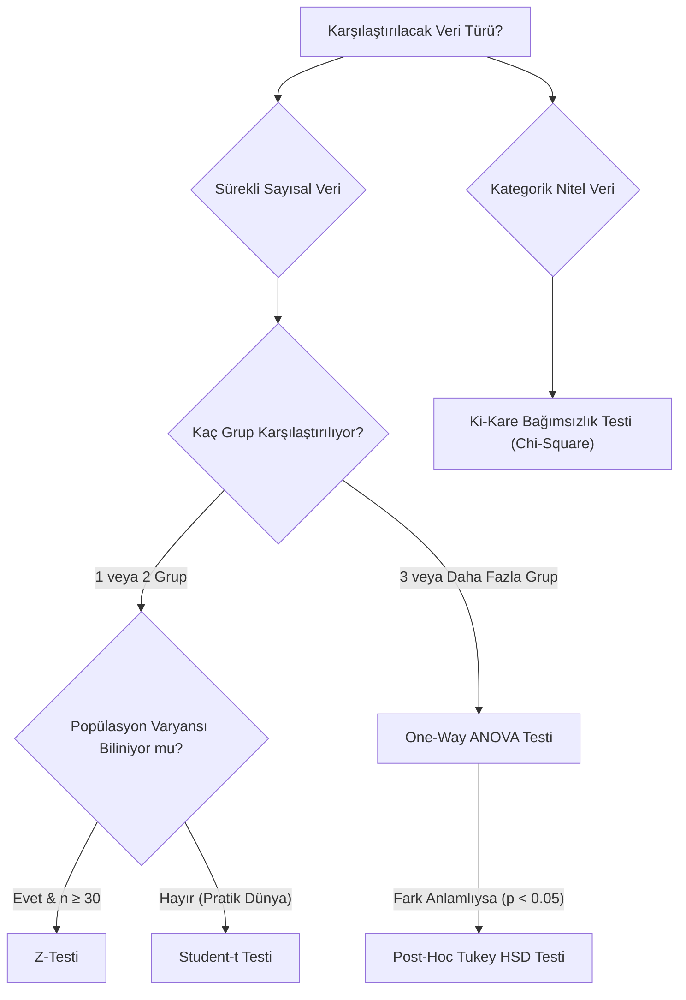

# 🧪 Hipotez Testleri ve İstatistiksel Karar Alma (Hypothesis Testing)

[](https://www.python.org/)
[](https://jupyter.org/)
[](https://scipy.org/)
[](https://www.statsmodels.org/)

Veri bilimi, makine öğrenmesi, ürün yönetimi ve A/B testlerinde veri temelli karar verme süreçlerinin temelini oluşturan **Parametrik ve Parametrik Olmayan Hipotez Testleri** laboratuvarı.

---

## 🧭 Hangi Test Ne Zaman Kullanılır? (Karar Matrisi)



---

## 📚 Notebook Serisi ve İçerik

| Notebook | Açıklanan Testler | Temel Formüller | Gerçek Hayat Örnekleri |
| :--- | :--- | :--- | :--- |
| **[`hypothesis_testing.ipynb`](hypothesis_testing.ipynb)** | **Tek Örneklem Z-Testi & T-Testi** | $Z = \frac{\bar{X}-\mu}{\sigma/\sqrt{n}}$, $t = \frac{\bar{X}-\mu}{s/\sqrt{n}}$ | Şişe su dolum kontrolü, IT ekibi Agile hız testi, Kahve porsiyon standardı, İlaç etkinliği |
| **[`anova_test.ipynb`](anova_test.ipynb)** | **Tek Yönlü ANOVA & Tukey HSD** | $F = \frac{MS_{\text{between}}}{MS_{\text{within}}}$, $\alpha_{\text{FW}}$ düzeltmesi | 3 Farklı eğitim metodunun sınav skorları, Satış yöntemleri karşılaştırması, Çalışma ortamı verimliliği |
| **[`chi_square_test.ipynb`](chi_square_test.ipynb)** | **Ki-Kare ($\chi^2$) Bağımsızlık Testi** | $\chi^2 = \sum \frac{(O - E)^2}{E}$, Kontenjans tablosu | Hafta içi/sonu müşteri memnuniyeti ilişkisi, Cinsiyete göre ürün tercihleri, Sigara bağımlılığı analizi |

---

## 💡 Temel İstatistiksel İlkeler

1. **p-değeri Yorumlama:**
   - $p < 0.05 \implies$ $H_0$ **reddedilir**. Fark istatistiksel olarak **anlamlıdır** (şans eseri değildir).
   - $p \ge 0.05 \implies$ $H_0$ **reddedilemez**. Gözlenen fark tesadüfi dalgalanmalardan kaynaklanıyor olabilir.

2. **I. Tip ve II. Tip Hata:**
   - **Tip I Hata ($\alpha$):** Gerçekte doğru olan $H_0$'ı yanlışlıkla reddetmek (Yanlış Pozitif / False Alarm).
   - **Tip II Hata ($\beta$):** Gerçekte yanlış olan $H_0$'ı reddedememek (Yanlış Negatif / Miss).

---

## 🚀 Kurulum ve Çalıştırma

```bash
pip install -r requirements.txt
jupyter notebook
```
