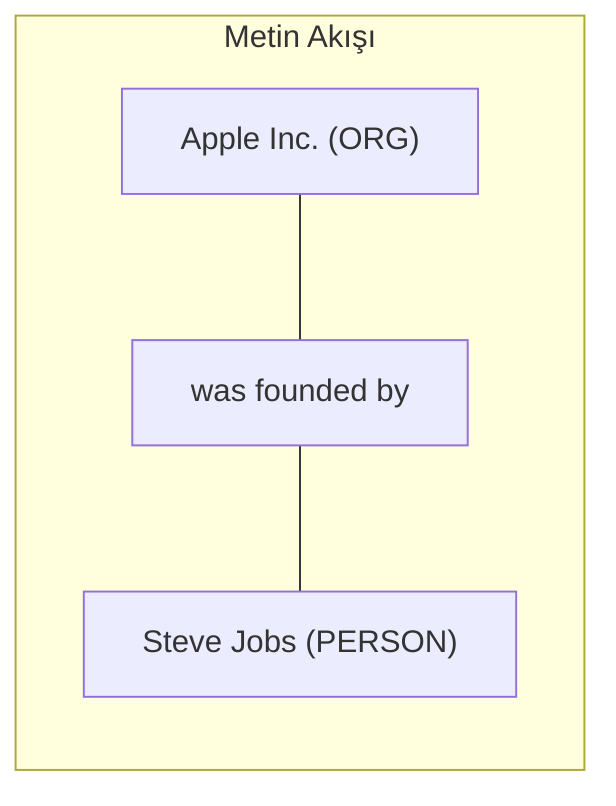

# 🧠 İleri Doğal Dil İşleme ve Metin Madenciliği (Advanced NLP)

[](https://www.python.org/)
[](https://jupyter.org/)
[](https://spacy.io/)
[](https://scikit-learn.org/)

Türkçe dilinin sondan eklemeli yapısına özel çözümler, kural ve makine öğrenmesi tabanlı varlık tanıma (NER), duygu analizi ve uçtan uca haber metin sınıflandırma sistemleri.

---

## 📚 Projeler ve Notebook İçerikleri

| Notebook | Konu & Proje | Kapsam & Detaylar |
| :--- | :--- | :--- |
| **[`spacy.ipynb`](spacy.ipynb)** | **Varlık Tanıma (Named Entity Recognition - NER)** | `en_core_web_sm` modeli, `displaCy` görselleştirme motoru, Kural tabanlı `Matcher` ile özel varlık kalıpları tanımlama |
| **[`TurkceNLP.ipynb`](TurkceNLP.ipynb)** | **Türkçe Morfolojik Analiz** | Sondan eklemeli dil yapısı, çoklu ek analizleri, Zeyrek / Zemberek mimarisi |
| **[`sentiment_analyses.ipynb`](sentiment_analyses.ipynb)** | **Duygu Analizi (Sentiment Analysis)** | Sözlük tabanlı (Lexicon/VADER) vs Makine Öğrenmesi (TF-IDF + Lojistik Regresyon), polarite ve sübjektiflik skorları |
| **[`BBCHaberAnalizi.ipynb`](BBCHaberAnalizi.ipynb)** | **BBC Haber Metin Sınıflandırma (Uçtan Uca Proje)** | Gerçek veri çekme, metin temizliği, BoW vs TF-IDF karşılaştırması, Naive Bayes / Logistic Regression eğitimi ve modelin `.pkl` olarak kaydedilmesi |

---

## 🎨 displaCy Varlık Görselleştirme Örneği



---

## 🛠️ Kurulum ve Çalıştırma

```bash
pip install -r requirements.txt
python -m spacy download en_core_web_sm
jupyter notebook
```
