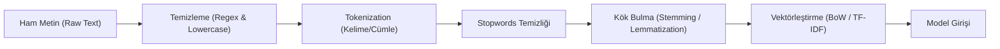

# 🔤 Doğal Dil İşleme Temelleri (NLP Fundamentals)

[](https://www.python.org/)
[](https://jupyter.org/)
[](https://www.nltk.org/)
[](https://scikit-learn.org/)

Metin verilerinin makine öğrenmesi algoritmaları tarafından anlaşılabilir sayısal vektörlere dönüştürülmesi için uygulanan temel ön işleme (preprocessing) ve vektörleştirme (vectorization) teknikleri.

---

## 🧭 Metin Ön İşleme ve Vektörleştirme Akışı



---

## 📚 Notebook Serisi ve İçerik

| Notebook | Konu | Temel Kavramlar & Kütüphaneler |
| :--- | :--- | :--- |
| **[`tokenization.ipynb`](tokenization.ipynb)** | **Belgeyi Parçalama (Tokenization)** | Kelime, Cümle ve Alt-kelime (Subword/BPE) tokenization seviyeleri (`nltk.word_tokenize`, `sent_tokenize`) |
| **[`Kok.ipynb`](Kok.ipynb)** | **Kök Bulma (Stemming vs Lemmatization)** | PorterStemmer, SnowballStemmer, WordNetLemmatizer kural tabanlı ve sözlük tabanlı kök ayrıştırması |
| **[`nlp.ipynb`](nlp.ipynb)** | **Ön İşleme Boru Hattı** | Küçük harfe çevirme, noktalama işaretleri temizliği, regex filtreleme |
| **[`calisma.ipynb`](calisma.ipynb)** | **Türkçe & İngilizce NLP Laboratuvarı** | Dil tespiti, İngilizce NLTK pipeline'ı, **Zeyrek Türkçe Morfolojik Analizörü** ile Türkçe lemmatization |
| **[`BagOfWords.ipynb`](BagOfWords.ipynb)** | **Kelime Çantası Modeli (Bag of Words - BoW)** | `CountVectorizer`, Terim-Belge Matrisi (DTM), Vokabüler boyutu, N-gram yapılandırması |
| **[`TF-IDF.ipynb`](TF-IDF.ipynb)** | **TF-IDF Vektörleştirme** | Terim Sıklığı (TF), Ters Belge Sıklığı (IDF) matematiksel formülleri, `TfidfVectorizer` |

---

## 📐 TF-IDF Matematiksel Formülü

$$\text{TF-IDF}(t, d, D) = \text{TF}(t, d) \times \text{IDF}(t, D)$$

$$\text{TF}(t, d) = \frac{f_{t, d}}{\sum_{t' \in d} f_{t', d}}, \quad \text{IDF}(t, D) = \log\left(\frac{1 + |D|}{1 + |\{d \in D : t \in d\}|}\right) + 1$$

---

## 🛠️ Kurulum ve Çalıştırma

```bash
pip install -r requirements.txt
python -m nltk.downloader punkt stopwords wordnet
jupyter notebook
```
